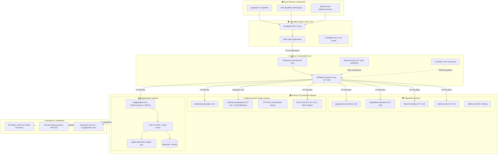
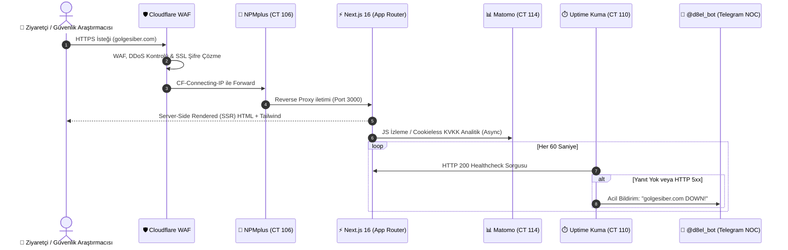
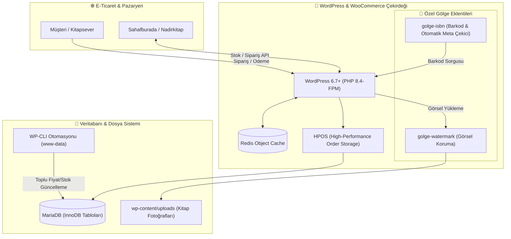

# 🗺️ GölgeSiber Dijital Ekosistem Mimari & Orkestrasyon Haritası

> **Son Güncelleme:** `2026-11-27T12:32:00+03:00`  
> **Durum:** Canlı Üretim Ortamı (Active Production)  
> **Kapsam:** GölgeSiber Veri Merkezi (Proxmox VE), Dalaman Airport Suites (STR & Bot), GölgeKitabevi (WooCommerce)

---

## 1. 🌐 Genel Ekosistem Üst Düzey Ağ Topolojisi



---

## 2. 🛡️ `golgesiber.com` Derin Mimari Haritası



---

## 3. 🏨 `dalamanairportsuites.com` Rezervasyon, Misafir & Kasa Akışı

```mermaid
flowchart LR
    subgraph Channels["📲 Kanallar & Misafir"]
        Site["dalamanairportsuites.com"]
        OTA["Airbnb / Booking.com"]
        GuestWA["Misafir WhatsApp"]
    end

    subgraph BotEngine["🤖 Rezervasyon & İletişim Motoru (CT 116)"]
        FastAPI["FastAPI Webhook Handler"]
        Baileys["Baileys Socket (Mode A)"]
        MetaAPI["Meta Cloud API (Mode B)"]
        RouterMesaj Yönlendirici
    end

    subgraph Property["🏡 Daire 11 (Sirius Rezidans)"]
        Keybox["7/24 Şifreli Keybox"]
        WiFi["UniFi U6-Pro (CT 107 - 5651 Log)"]
        AC["Klima / Elektrik"]
    end

    subgraph Accounting["💰 Kasa & Muhasebe Motoru"]
        KasaLedger["Nakit / Banka Girişi"]
        TaxEngine["KDV (%10/%20) + Konaklama Vergisi (%2)"]
        ProfitSplit["Ortak Kar Dağıtımı (%50 - %50)"]
    end

    Site -->|Rezervasyon Talebi| FastAPI
    OTA -->|Rezervasyon Senkronu| FastAPI
    GuestWA <--> Baileys
    Baileys <--> Router
    MetaAPI <--> Router
    Router <--> FastAPI

    FastAPI -->|Giriş Kodu & Yol Tarifi| GuestWA
    FastAPI -->|Şifre Üretimi| Keybox
    FastAPI -->|Wi-Fi Şifresi| WiFi
    FastAPI -->|Gelir Kaydı| KasaLedger

    KasaLedger --> TaxEngine
    TaxEngine --> ProfitSplit
```

---

## 4. 📚 `golgekitabevi.com` WooCommerce & Sahaf Entegrasyon Haritası


